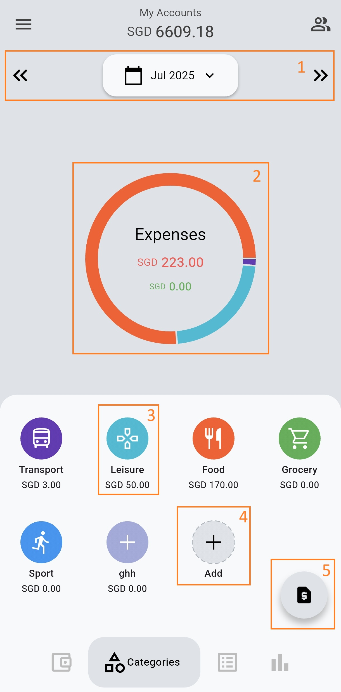
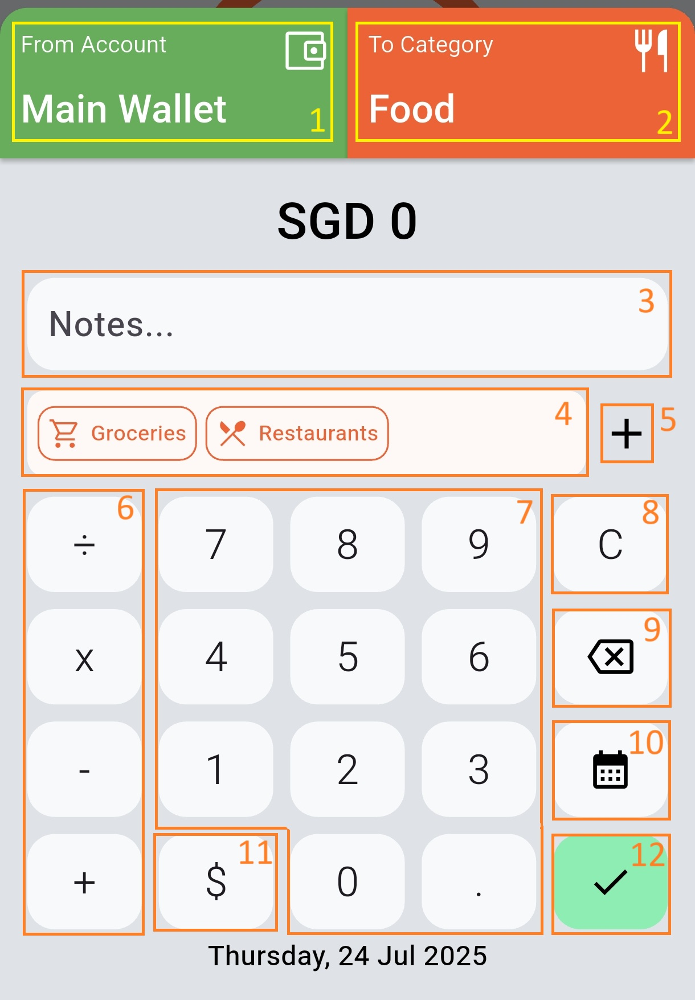
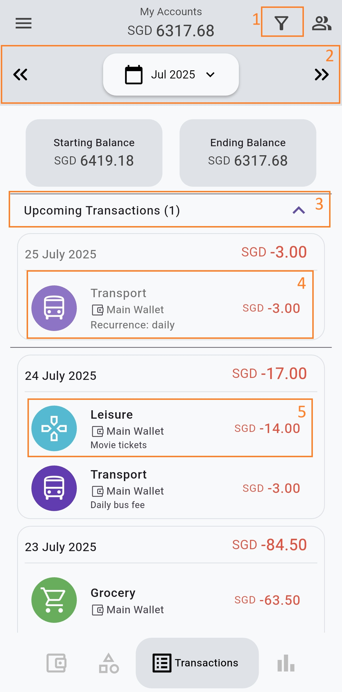
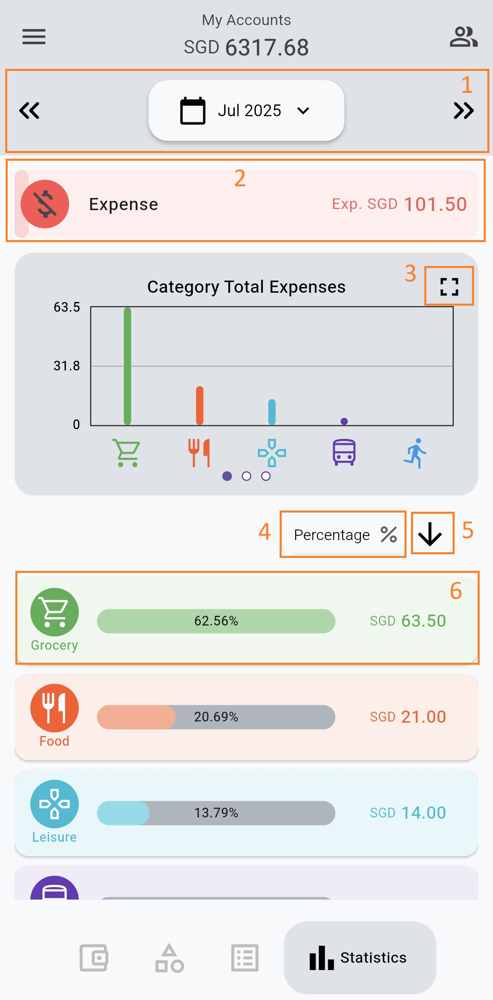

<div align="center">


# Money Minder

**A clean, fast personal expense tracker for Android and iOS, built with Flutter.**

Log a purchase in two taps, see where your money goes each month, and keep your data private on your own phone.


</div>

---

## At a glance

| | |
|---|---|
| **What it is** | A mobile app that helps people track spending, set budgets and understand their habits. |
| **Who it's for** | Students and young professionals who want a simple, private way to manage money. |
| **What I built** | The full app: UI, local database, cloud backup, security features, charts and tests. |
| **Tech** | Flutter and Dart, SQLite for on-device data, Firebase for sign-in and cloud backup. |
| **Scale** | About 22,000 lines of Dart, 140+ source files, 45 unit test files, 280+ commits across 60+ pull requests. |

## Screenshots

<p align="center">
  
  &nbsp;
  
  &nbsp;
  
  &nbsp;
  
</p>
<p align="center">
  <sub>Category overview &nbsp;·&nbsp; Quick entry keypad &nbsp;·&nbsp; Transaction history &nbsp;·&nbsp; Statistics</sub>
</p>

<sub>Numbered highlights come from the app's built-in tutorial.</sub>

## Key features

### Track spending quickly
- **Built-in calculator keypad.** Type `12.50 + 3` and the app works out the total for you.
- **Quick notes.** Save common descriptions like "Groceries" or "Bus fare" and reuse them in one tap.
- **Recurring transactions.** Set up rent, subscriptions or a daily bus fare once and they are logged automatically.
- **Transfers between accounts.** Move money between wallets, bank accounts or cards.

### Understand your money
- **Category view.** A ring chart shows how much went to food, transport, leisure and more.
- **Statistics page.** Bar, line and stacked charts compare spending across categories and time periods.
- **Flexible time filters.** Switch between day, week, month, year or a custom range.
- **Budgets.** Set spending limits per category and watch progress bars fill up.

### Stay in control
- **Multiple accounts.** Separate cash, bank and card balances, each with its own colour and icon.
- **19 currencies.** Includes SGD, MYR, USD, EUR, JPY and other Asian currencies.
- **Custom categories.** Pick your own icons and colours.
- **Daily reminders.** Optional notifications nudge you to log the day's spending.

### Keep data safe
- **Passcode lock with biometrics.** Unlock with fingerprint or face, with a passcode as backup.
- **Brute-force protection.** Wrong passcode attempts lock the app for longer and longer periods.
- **Secure storage.** Passcodes are salted and hashed, never stored as plain text.
- **Backup and restore.** Sign in with Google to back up to the cloud, or export and import CSV files.

### Social features (paused)
The app also includes contacts, money requests and bill splitting between users. These are currently turned off while they are being reworked, and are planned to return in a later version.

## How it's built

```
lib/
├── pages/                  Full screens (accounts, categories, transactions, statistics, settings)
├── components/             Reusable UI pieces (input keypad, charts, lock screen, budgets)
├── models/                 Data classes such as Transaction, Account, Budget and Recurrence
├── repositories/           Reads and writes to the on-device SQLite database
├── firestore_repositories/ Reads and writes to Firebase for backup and online features
├── db/                     Database setup and schema
└── style/                  Shared colours, sizes and themes
```

**Design choices worth noting**
- **Offline first.** All data lives in SQLite on the device, so the app works without internet and stays fast.
- **Repository pattern.** Screens never talk to the database directly, which keeps the UI simple and makes the data layer easy to test.
- **Optional cloud.** Firebase is only used for sign-in and backup, so users who never sign in keep everything local.
- **Responsive layout.** Text and spacing scale to fit different phone sizes.
- **In-app tutorial.** Every main screen has an annotated guide for new users.

## Testing

The project has unit tests for data models, helper functions, local repositories and Firebase repositories. Firebase is mocked with `mockito` and `fake_cloud_firestore`, so tests run without a network connection.

```bash
flutter test
```

## Run it yourself

**You need:** the [Flutter SDK](https://docs.flutter.dev/get-started/install) version 3.32 or newer, plus an Android emulator, iOS simulator or a real phone.

```bash
git clone https://github.com/Beastarz/money_minder.git
cd money_minder
flutter pub get
flutter run
```

The app opens straight to the main screen. Signing in with Google is optional and only needed for cloud backup.

## Tech stack

| Area | Tools |
|---|---|
| Framework | Flutter, Dart |
| Local storage | `sqflite` (SQLite) |
| Cloud | Firebase Authentication, Cloud Firestore, Google Sign-In |
| Charts | `fl_chart`, `percent_indicator` |
| Security | `local_auth` for biometrics, `crypto` for salted hashing |
| Notifications | `flutter_local_notifications`, `timezone` |
| Data import and export | `csv`, `file_picker`, `docx_to_text` |
| Testing | `flutter_test`, `mockito`, `fake_cloud_firestore` |

## Roadmap

- Bring back social features: contacts, money requests and bill splitting.
- Add a dark mode toggle. The theme already exists and needs a switch in settings.
- Publish to the Google Play Store and Apple App Store.
